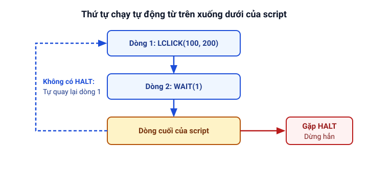

# Viết script đầu tiên

Trang này hướng dẫn từng bước cách nạp và chạy một script Clickermann từ cơ bản nhất: bắt đầu bằng thao tác bấm chuột lặp lại, mở cửa sổ nhật ký để xem biến đếm, thêm câu lệnh điều kiện và kết hợp chụp màn hình với `GETSCREEN`.

## Chạy một script

Mỗi khi viết mới hoặc chỉnh sửa mã lệnh trong Clickermann, bạn thực hiện theo đúng 6 bước sau:

1. Mở [Trình soạn thảo](/bat-dau/trinh-soan-thao) từ cửa sổ chính.
2. Gõ nội dung script vào khung soạn thảo bên phải.
3. Nhấn `Ctrl + S` để lưu tệp vào **một thư mục riêng** (gọi là **thư mục dự án**) với phần mở rộng `.cms`.
4. Bấm nút **Áp dụng** (ở cột bên trái của Trình soạn thảo) để chương trình nạp nội dung bạn vừa viết. *(Nếu quên bấm Áp dụng, Clickermann sẽ vẫn chạy nội dung cũ trước đó).*
5. Nhấn phím tắt **`Alt + A`** (hoặc bấm nút **Chạy**) để bắt đầu chạy script.
6. Nhấn phím tắt **`Alt + S`** (hoặc bấm nút **Dừng**) bất cứ lúc nào muốn dừng hẳn script.

## Cơ chế chạy lặp tự động của script

Trong Clickermann, một script gồm các dòng lệnh được thực thi lần lượt **từ trên xuống dưới**. Khi chạy xong dòng cuối cùng, chương trình sẽ **tự động quay lại dòng đầu tiên** và lặp lại quy trình đó cho tới khi bạn nhấn `Alt + S` để dừng hoặc gặp lệnh [`HALT`](/lenh/kich-ban#halt).



## Bước 1: Script bấm chuột mỗi giây một lần

Hãy bắt đầu bằng ví dụ đầu tiên: bấm chuột trái vào tọa độ `(100, 200)` rồi chờ 1 giây.

::: warning Chuẩn bị trước khi bấm chạy
Mở một cửa sổ **Notepad** trống đặt che lên vùng góc trên bên trái màn hình tại điểm `(100, 200)`, kéo cửa sổ Clickermann tránh xa điểm này, và nhớ sẵn phím tắt **`Alt + S`** để dừng trước khi bấm chạy.
:::

```cms
// Bấm chuột trái vào tọa độ X=100, Y=200
LCLICK(100, 200)

// Tạm dừng chờ 1 giây
WAIT(1)
```

Giải thích từng dòng:

- Dòng bắt đầu bằng `//` là **chú thích**, chỉ dùng để ghi chú cho người đọc, chương trình sẽ bỏ qua không chạy.
- [`LCLICK(100, 200)`](/lenh/chuot#lclick) là lời gọi thủ tục bấm chuột trái tại tọa độ màn hình `X = 100`, `Y = 200`. Mỗi dòng chỉ được viết một lệnh.
- [`WAIT(1)`](/lenh/kich-ban#wait) làm script tạm dừng `1` giây trước khi chuyển sang bước tiếp theo. Nếu cần chờ số lẻ thập phân, hãy dùng dấu chấm (ví dụ `WAIT(0.5)` để chờ nửa giây).
- Sau khi hết lệnh `WAIT(1)`, script tự quay lại dòng 1 và tiếp tục bấm chuột mỗi giây một lần. Nhấn **`Alt + S`** để dừng lại. Nếu bạn chỉ muốn bấm đúng một lần rồi tự dừng, hãy thêm dòng `HALT` ở cuối script.

## Bước 2: Thêm biến để đếm số lần đã bấm

Biến là một ô nhớ có tên bắt đầu bằng dấu `$` (ví dụ `$count`). Mọi biến chưa được gán giá trị ban đầu sẽ tự động mang giá trị `0` ở lần đọc đầu tiên, và giữ nguyên giá trị đang có khi script tự quay lại đầu vòng lặp.

Ta nâng cấp script ở Bước 1 để đếm tổng số lần đã bấm chuột và in ra cửa sổ nhật ký bằng lệnh [`PRINT`](/lenh/nhat-ky#logwrite-print):

```cms
// Bấm chuột trái
LCLICK(100, 200)

// Chờ 1 giây
WAIT(1)

// Tăng biến đếm thêm 1 đơn vị
$count = $count + 1

// In thông báo ra cửa sổ nhật ký
PRINT("So lan bam: ", $count)
```

Sau khi bấm **Áp dụng** và nhấn **`Alt + A`** để chạy, hãy **bấm nút Nhật ký trên Trình soạn thảo** (ở cột bên trái, dưới nút Dừng) để mở cửa sổ nhật ký và xem dòng chữ `So lan bam: 1`, `So lan bam: 2`... hiện ra mỗi giây. Nhấn **`Alt + S`** khi muốn dừng script.

::: tip Về lệnh PRINT / LOGWRITE và chuỗi không dấu
- Trong Clickermann, hai tên lệnh `PRINT` và `LOGWRITE` hoàn toàn là một (tên gọi khác nhau của cùng một lệnh in ra cửa sổ nhật ký). Các trang hướng dẫn và cẩm nang dùng thống nhất `PRINT` cho ngắn gọn; khi đọc phần tra cứu lệnh bạn có thể gặp cả `LOGWRITE`.
- Các câu thông báo đặt trong dấu ngoặc kép `"..."` ở ví dụ được viết bằng tiếng Việt không dấu (như `"So lan bam: "`) vì tiếng Việt có dấu chưa được chạy thử.
:::

Nếu muốn bấm vào vị trí ngẫu nhiên trong vùng từ `100` đến `150` và chờ ngẫu nhiên từ `3` đến `5` giây, bạn có thể kết hợp hàm [`RND`](/lenh/so#rnd) ngay trong tham số (nhấn `Alt + S` khi muốn dừng):

```cms
// Bấm chuột vào tọa độ ngẫu nhiên từ 100 đến 150
LCLICK(RND(50, 100) + 50, RND(50, 100) + 50)

// Chờ ngẫu nhiên từ 3 đến 5 giây
WAIT(RND(3, 5))

// Tăng biến đếm
$count = $count + 1

// In thông báo
PRINT("So lan bam: ", $count)
```

## Bước 3: Thêm câu lệnh điều kiện `IF`

Để script tự đưa ra quyết định tùy theo tình huống, ta dùng cấu trúc [`IF ... END_IF`](/lenh/cau-truc#if-end-if). Ví dụ dưới đây kiểm tra nếu số ngẫu nhiên lớn hơn `5` thì mới in thông báo, và tự dừng lại bằng `HALT` sau khi chạy đủ 5 lượt:

```cms
// Sinh một số ngẫu nhiên từ 1 đến 10
$var = RND(1, 10)

// Kiểm tra điều kiện: nếu $var lớn hơn 5 thì in ra nhật ký
IF($var > 5)
   PRINT($var, " > 5")
END_IF

// Đếm số lượt chạy và dừng hẳn sau 5 lượt
$count = $count + 1
IF($count >= 5)
   PRINT("Da chay du 5 luot, dung script.")
   HALT
END_IF

WAIT(1)
```

## Bước 4: Đọc màu màn hình với `GETSCREEN`

Khi muốn script nhìn thấy màu sắc hoặc hình ảnh trên màn hình, bạn **bắt buộc phải gọi [`GETSCREEN`](/lenh/man-hinh#getscreen)** trước để chương trình chụp màn hình vào [bộ đệm ảnh](/khai-niem/bo-dem-anh), sau đó mới dùng các lệnh kiểm tra màu như [`IF_PIXEL_IN`](/lenh/man-hinh#if-pixel-in-end-if).

Trong khối kiểm tra, các dòng nằm sau từ khóa **`ELSE`** sẽ được chạy khi điều kiện **không** thỏa mãn (tức là không tìm thấy màu cần tìm trong vùng quét):

```cms
// 1. Chụp màn hình hiện tại vào bộ đệm ảnh
GETSCREEN

// 2. Tìm điểm ảnh màu đỏ (255) trong vùng từ (10, 20) đến (100, 40)
IF_PIXEL_IN(10, 20, 100, 40, 255)
   // Nếu tìm thấy, tọa độ nằm sẵn trong $_return1 (X) và $_return2 (Y)
   PRINT("Tim thay mau do tai: ", $_return1, ", ", $_return2)
   LCLICK($_return1, $_return2)
ELSE
   // Chạy nhánh ELSE khi không tìm thấy màu đỏ trong vùng quét
   PRINT("Khong tim thay mau do trong vung quet")
END_IF

HALT
```

---

*Nguồn: Tài liệu trợ giúp `help.chm` (phần Giới thiệu ngôn ngữ và Màn hình).*
