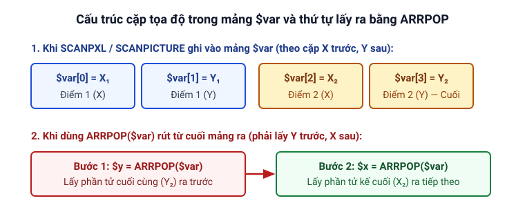

# Cẩm nang: Tìm màu trên màn hình rồi bấm chuột

Trang này hướng dẫn từng bước cách lấy mã màu trên màn hình và dùng `GETSCREEN`, `IF_PIXEL_IN`, `SCANPXL` để tìm điểm ảnh có màu chỉ định rồi tự động bấm chuột vào vị trí tìm thấy.

## Bước 0: Đọc mã màu cần tìm trong Trình soạn thảo

Trước khi viết lệnh tìm màu, bạn cần biết con số mã màu của điểm ảnh trên màn hình máy bạn:

1. Mở cửa sổ [Trình soạn thảo](/bat-dau/trinh-soan-thao) (có thể bật thêm **Kính lúp** để nhìn rõ từng điểm ảnh; nhớ **tắt kính lúp** sau khi lấy xong nếu thấy chuột di chuyển chậm).
2. Đưa con trỏ chuột trỏ đúng vào điểm màu cần tìm trên màn hình.
3. Nhìn sang khung thông tin ở **cột bên trái** của Trình soạn thảo để đọc **mã màu** hiện tại dưới mũi chuột (hoặc nhấn phím tắt **`Alt + Q`** để chèn nhanh tọa độ và mã màu vào script).

::: tip Số 255 trong bài chỉ là ví dụ
Trong các đoạn code bên dưới, số `255` (màu đỏ thuần) và `65280` (màu xanh lá thuần) chỉ là số ví dụ minh họa. Khi áp dụng vào công việc của bạn, hãy **thay con số đó bằng mã màu thực tế** mà bạn vừa đọc được ở Bước 0.
:::

## Quy trình chuẩn khi tìm màu

Mọi kịch bản tìm màu trong Clickermann đều đi theo 3 bước cố định:

1. **Chụp màn hình vào bộ đệm ảnh:** Gọi [`GETSCREEN`](/lenh/man-hinh#getscreen) (hoặc `GETSCREEN(x1, y1, x2, y2)` nếu chỉ cần chụp vùng nhỏ). Nếu không có bước này, chương trình sẽ không nhìn thấy những gì mới xuất hiện trên màn hình.
2. **Tìm điểm màu trong bộ đệm ảnh:**
   - Dùng [`IF_PIXEL_IN`](/lenh/man-hinh#if-pixel-in-end-if) nếu chỉ cần tìm **điểm đầu tiên** khớp màu.
   - Dùng [`SCANPXL`](/lenh/man-hinh#scanpxl) nếu cần lấy danh sách **tất cả các điểm** khớp màu trong vùng.
3. **Thao tác với tọa độ tìm được:** Với `IF_PIXEL_IN`, tọa độ tìm thấy nằm trong hai biến hệ thống `$_return1` (X) và `$_return2` (Y).

---

## Tình huống 1: Tìm một màu và bấm chuột ngay khi thấy

Giả sử bạn cần theo dõi vùng màn hình từ `(100, 100)` đến `(500, 400)`: nếu xuất hiện thông báo có điểm màu đỏ (`255`) thì bấm chuột trái vào đúng điểm đó; nếu chưa thấy thì chờ `100` mili-giây rồi quét lại.

### Giải thích từng bước

1. Gọi `GETSCREEN(100, 100, 500, 400)` để cập nhật vùng cần theo dõi vào bộ đệm ảnh.
2. Dùng `IF_PIXEL_IN(100, 100, 500, 400, 255)` để tìm mã màu `255`.
3. Nếu tìm thấy, gọi `LCLICK($_return1, $_return2)` để bấm vào tọa độ vừa tìm được.
4. Nếu không thấy (nhánh `ELSE`), gọi `WAITMS(100)` để nghỉ ngắn trước khi lặp lại vòng sau (vì script không có `HALT` nên sẽ lặp vô tận; nhấn phím tắt **`Alt + S`** khi muốn dừng).

```cms
// Cập nhật vùng màn hình (100, 100) -> (500, 400) vào bộ đệm ảnh
GETSCREEN(100, 100, 500, 400)

// Tìm điểm ảnh màu đỏ (255) trong vùng đó
IF_PIXEL_IN(100, 100, 500, 400, 255)
   PRINT("Tim thay mau tai X=", $_return1, " Y=", $_return2)
   LCLICK($_return1, $_return2)
   WAIT(1)
ELSE
   // Chưa thấy màu -> nghỉ 100ms để không làm nặng CPU
   WAITMS(100)
END_IF
```

---

## Tình huống 2: Chờ cho tới khi màu xuất hiện rồi mới đi tiếp

Khi một công việc văn phòng có nhiều bước nối tiếp nhau (ví dụ: bấm nút "Xuất báo cáo", chờ thanh trạng thái đổi sang màu xanh lá `65280` báo hoàn tất rồi mới bấm nút "Đóng" ở tọa độ `300, 120`), bạn đặt `GETSCREEN` và `IF_PIXEL_IN` bên trong vòng lặp [`WHILE ... END_CYC`](/lenh/cau-truc#while-end-cyc).

*(Lưu ý: vòng lặp `WHILE` dưới đây có thể chờ mãi nếu màu `65280` không bao giờ xuất hiện trên vùng quét; khi đó bạn có thể dừng script bằng phím tắt **`Alt + S`**).*

```cms
// Bước 1: Bấm nút bắt đầu công việc
LCLICK(150, 120)
PRINT("Dang cho bieu tuong hoan tat mau xanh la (65280)...")

// Bước 2: Lặp kiểm tra cho tới khi thấy màu 65280 trong vùng (200, 200) -> (250, 250)
$thay_mau = 0
WHILE($thay_mau = 0)
   GETSCREEN(200, 200, 250, 250)
   IF_PIXEL_IN(200, 200, 250, 250, 65280)
      $thay_mau = 1
      PRINT("Da thay mau hoan tat tai: ", $_return1, ", ", $_return2)
   ELSE
      WAITMS(100)
   END_IF
END_CYC

// Bước 3: Sau khi vòng lặp kết thúc, bấm vào nút Đóng tại (300, 120)
LCLICK(300, 120)
PRINT("Da bam nut Dong va xong quy trinh.")
HALT
```

---

## Tình huống 3: Quét toàn bộ các điểm cùng màu bằng `SCANPXL`

Khi trên màn hình có nhiều điểm cùng mang mã màu `255` và bạn muốn lấy tọa độ của tất cả các điểm đó, hãy dùng thủ tục [`SCANPXL`](/lenh/man-hinh#scanpxl).



### Giải thích từng bước

1. Gọi `GETSCREEN` để chụp màn hình vào bộ đệm ảnh.
2. Gọi `SCANPXL($var, 0, 0, 500, 500, 255)` để đưa toàn bộ các cặp tọa độ `(X, Y)` tìm thấy vào mảng `$var`.
3. Dùng vòng lặp `WHILE(ARRSIZE($var) > 0)` kết hợp [`ARRPOP`](/lenh/so#arrpop) để lấy tọa độ từ cuối mảng ra. Lưu ý vì mảng lưu theo thứ tự `[X1, Y1, X2, Y2, ...]`, khi rút từ cuối mảng bằng `ARRPOP`, bạn phải **rút `$y` trước rồi mới rút `$x`**.

```cms
GETSCREEN

// Tìm tất cả điểm ảnh màu đỏ (255) trong vùng 0,0 -> 500,500
SCANPXL($var, 0, 0, 500, 500, 255)
PRINT("Tong so phan tu trong mang (2 * so diem): ", ARRSIZE($var))

// Rút lần lượt từng cặp tọa độ từ cuối mảng ra
WHILE(ARRSIZE($var) > 0)
   $y = ARRPOP($var)
   $x = ARRPOP($var)
   PRINT("Diem tim thay -> X: ", $x, " | Y: ", $y)
END_CYC

HALT
```

---

*Nguồn: Tài liệu trợ giúp `help.chm` (mục Màn hình, bài Trình soạn thảo và mục Làm việc với số).*
