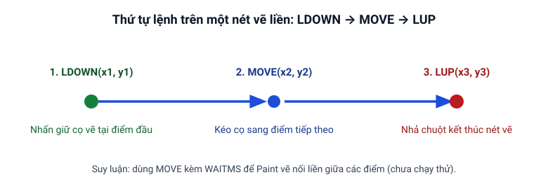

# Cẩm nang: Tự động vẽ hình trong Paint

Trang này hướng dẫn từng bước cách dùng các lệnh điều khiển chuột (`LDOWN`, `MOVE`, `LUP`), hàm lượng giác (`SIN`, `COS`) và lệnh đọc tệp văn bản để tự động vẽ đoạn thẳng, hình vuông, đường tròn và hình theo danh sách tọa độ trong chương trình Paint của Windows.

## Chuẩn bị trước khi chạy và nguyên tắc vẽ bằng chuột

Trước khi chạy các đoạn script bên dưới, bạn cần chuẩn bị cửa sổ **Paint** như sau:

1. Mở chương trình **Paint**, phóng to cửa sổ và bảo đảm vùng giấy vẽ trắng bao phủ toàn bộ các tọa độ sẽ vẽ (trong các ví dụ bên dưới, mọi tọa độ `Y` đều được đặt từ **`220` trở xuống** — tức vùng `X = 200..450`, `Y = 220..420` — để tránh bấm nhầm vào thanh công cụ Ribbon ở phía trên của Paint).
2. Chọn sẵn công cụ **Cọ vẽ (Brushes)** hoặc **Bút chì (Pencil)** và chọn màu nét vẽ khác màu trắng.
3. **Không để cửa sổ Clickermann che lên vùng giấy vẽ:** Sau khi bấm nút **Áp dụng** trong [Trình soạn thảo](/bat-dau/trinh-soan-thao), hãy kéo cửa sổ Clickermann sang một bên (hoặc đưa cửa sổ Paint lên phía trước), rồi dùng phím tắt toàn cục **`Alt + A`** để bắt đầu chạy và **`Alt + S`** nếu cần dừng khẩn cấp.

**Nguyên tắc tạo nét kéo chuột:**

1. Đưa cọ tới điểm đầu tiên và **nhấn giữ chuột trái** bằng [`LDOWN(x, y)`](/lenh/chuot#ldown).
2. **Suy luận:** Trong khi chuột trái vẫn đang giữ, kéo con trỏ đi qua điểm tiếp theo bằng lệnh [`MOVE(x, y)`](/lenh/chuot#move) kèm khoảng chờ ngắn [`WAITMS`](/lenh/kich-ban#waitms) để Paint vẽ nối liền giữa các điểm (trong help, mục Chuột, ví dụ kéo thả chỉ viết 3 dòng `ldown(10, 10)`, `waitms(300)` rồi `lup(20, 20)` mà không có `MOVE` ở giữa — xem mục kiểm tra tại [Cần kiểm tra trên Windows](/phu-luc/can-kiem-tra-tren-windows#keo-chuot-ve-net-lien-bang-ldown-move-lup-trong-paint)).
3. Tại điểm cuối cùng của nét, **nhả nút chuột trái** bằng [`LUP(x, y)`](/lenh/chuot#lup).



---

## Bước 1: Vẽ một đoạn thẳng

Để vẽ một đoạn thẳng ngang từ điểm `(200, 250)` sang điểm `(450, 250)` trên khung vẽ của Paint:

```cms
// Chờ 2 giây để bạn đưa cửa sổ Paint lên phía trước
WAIT(2)

// Nhấn giữ chuột trái tại điểm đầu (200, 250)
LDOWN(200, 250)
WAITMS(50)

// Kéo chuột tới điểm cuối (450, 250) và nhả chuột trái
MOVE(450, 250)
WAITMS(50)
LUP(450, 250)

HALT
```

---

## Bước 2: Vẽ hình vuông khép kín

Hình vuông là một đường gấp khúc khép kín đi qua 4 đỉnh rồi quay về đỉnh xuất phát. Giả sử đỉnh góc trái trên là `(200, 230)` và cạnh hình vuông dài `150` điểm ảnh:

```cms
// Chờ 2 giây để chuyển sang cửa sổ Paint
WAIT(2)

// Bắt đầu đặt bút tại đỉnh trái trên (200, 230)
LDOWN(200, 230)
WAITMS(50)

// Kéo sang đỉnh phải trên (350, 230)
MOVE(350, 230)
WAITMS(50)

// Kéo xuống đỉnh phải dưới (350, 380)
MOVE(350, 380)
WAITMS(50)

// Kéo sang đỉnh trái dưới (200, 380)
MOVE(200, 380)
WAITMS(50)

// Kéo về lại đỉnh trái trên (200, 230) và nhả bút
MOVE(200, 230)
WAITMS(50)
LUP(200, 230)

HALT
```

---

## Bước 3: Vẽ đường tròn bằng hàm `SIN` và `COS`

Hai hàm lượng giác [`SIN(arg)`](/lenh/so#sin) và [`COS(arg)`](/lenh/so#cos) nhận tham số góc `arg` tính bằng **độ** (degrees). Một đường tròn đầy đủ có góc quét từ `0` đến `360` độ.

Với tâm đường tròn tại `($tam_x, $tam_y) = (350, 320)` và bán kính `$ban_kinh = 100` (tọa độ `Y` nằm trong khoảng `220..420`), tọa độ mỗi điểm trên đường tròn ứng với góc `$goc` (độ) được tính bằng công thức:

- `$x = $tam_x + INT($ban_kinh * COS($goc))`
- `$y = $tam_y + INT($ban_kinh * SIN($goc))`

```cms
// Chờ 2 giây để chuyển sang cửa sổ Paint
WAIT(2)

$tam_x = 350
$tam_y = 320
$ban_kinh = 100

// Điểm bắt đầu tại góc 0 độ
$x0 = $tam_x + INT($ban_kinh * COS(0))
$y0 = $tam_y + INT($ban_kinh * SIN(0))
LDOWN($x0, $y0)
WAITMS(20)

// Quét góc từ 5 đến 360 độ, mỗi bước tăng 5 độ
FOR($goc=5, $goc <= 360, 5)
   $x = $tam_x + INT($ban_kinh * COS($goc))
   $y = $tam_y + INT($ban_kinh * SIN($goc))
   MOVE($x, $y)
   WAITMS(15)
END_CYC

// Nhả chuột tại điểm cuối để hoàn tất đường tròn
LUP($x0, $y0)
HALT
```

---

## Bước 4: Đọc danh sách tọa độ điểm từ tệp `.txt` để vẽ

::: important Lưu tệp script vào thư mục dự án
Trước khi chạy Bước 4, hãy **tạo một thư mục riêng (thư mục dự án) và lưu tệp script `.cms` vào đó** để tệp `diem_ve.txt` được tạo và đọc ngay trong thư mục này.
:::

Khi cần vẽ một hình phức tạp gồm nhiều điểm nối tiếp nhau, bạn có thể lưu danh sách các điểm tọa độ `X,Y` vào một tệp văn bản `diem_ve.txt`, mỗi điểm trên một dòng:

```text
200,280
300,220
400,280
360,390
240,390
200,280
```

### Phần A: Tạo dữ liệu mẫu (chạy một lần, sẽ ghi đè tệp)

Chạy đoạn script ngắn dưới đây một lần để tạo tệp `diem_ve.txt` chứa 6 đỉnh của hình ngũ giác khép kín (dùng [`STRWRITELN`](/lenh/chuoi-file#strwriteln) với `rewrite = 1` ở dòng đầu để tạo mới tệp):

```cms
// Tạo mới tệp danh sách tọa độ mẫu "diem_ve.txt" (hình ngũ giác khép kín)
STRWRITELN("diem_ve.txt", "200,280", 1)
TFWRITE("diem_ve.txt", "300,220")
TFWRITE("diem_ve.txt", "400,280")
TFWRITE("diem_ve.txt", "360,390")
TFWRITE("diem_ve.txt", "240,390")
TFWRITE("diem_ve.txt", "200,280")

PRINT("Da tao xong tep diem_ve.txt")
HALT
```

### Phần B: Đọc dữ liệu và vẽ

Sau khi đã có tệp `diem_ve.txt`, bạn đưa cửa sổ Paint lên phía trước và nhấn **`Alt + A`** để chạy script đọc tọa độ bằng [`TFREAD`](/lenh/chuoi-file#tfread), tách `X, Y` bằng [`STRSEPARATE`](/lenh/chuoi-file#strseparate) và vẽ:

```cms
// Chờ 2 giây để bạn đưa cửa sổ Paint lên phía trước
WAIT(2)

$so_diem = TFCOUNT("diem_ve.txt")

// 1. Đọc điểm đầu tiên (dòng 1) để nhấn giữ chuột trái (LDOWN)
UNDEFINE($toa_do)
STRSEPARATE(TFREAD("diem_ve.txt", 1), ",", $toa_do)
$x_dau = INT($toa_do[0])
$y_dau = INT($toa_do[1])
LDOWN($x_dau, $y_dau)
WAITMS(40)

// 2. Duyệt từ điểm thứ 2 đến điểm cuối để kéo nét vẽ (MOVE)
FOR($i=2, $i <= $so_diem)
   UNDEFINE($toa_do)
   STRSEPARATE(TFREAD("diem_ve.txt", $i), ",", $toa_do)
   $x = INT($toa_do[0])
   $y = INT($toa_do[1])
   MOVE($x, $y)
   WAITMS(40)
END_CYC

// 3. Nhả chuột tại điểm cuối cùng
LUP($x, $y)
HALT
```

---

*Nguồn: Tài liệu trợ giúp `help.chm` (mục Chuột, mục Làm việc với số và mục Chuỗi và tệp).*
