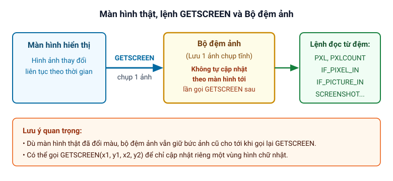

# Bộ đệm ảnh

Trang này giải thích cơ chế **bộ đệm ảnh** trong Clickermann, lý do bắt buộc phải gọi lệnh `GETSCREEN` trước khi đọc màu hay tìm ảnh và cách chỉ cập nhật một vùng màn hình để tăng tốc độ.

## Tại sao phải gọi `GETSCREEN`?

Các hàm và thủ tục đồ họa trong Clickermann (như [`PXL`](/lenh/man-hinh#pxl), [`PXLCOUNT`](/lenh/man-hinh#pxlcount), [`IF_PIXEL_IN`](/lenh/man-hinh#if-pixel-in-end-if), [`IF_PICTURE_IN`](/lenh/man-hinh#if-picture-in-end-if), [`SCANPXL`](/lenh/man-hinh#scanpxl), [`SCREENSHOT`](/lenh/man-hinh#screenshot)...) **không đọc trực tiếp từ màn hình đang hiển thị** mà đọc từ một bức ảnh chụp lưu trong bộ nhớ gọi là **bộ đệm ảnh**.

Cách thiết kế này có hai tác dụng chính:

1. **Tăng tốc độ xử lý:** Thay vì làm việc trực tiếp với màn hình đang hiển thị, các lệnh đồ họa đọc dữ liệu từ ảnh chụp trong bộ đệm ảnh giúp chương trình chạy nhanh hơn.
2. **Tạo "trí nhớ thị giác" cho chương trình:** Tại một thời điểm, trong bộ nhớ chỉ lưu duy nhất một bức ảnh chụp màn hình để các lệnh đồ họa trong script lấy dữ liệu từ đó.



Vì bộ đệm ảnh không tự động cập nhật khi màn hình bên ngoài thay đổi, mỗi khi bạn cần cập nhật trạng thái màn hình lưu trong bộ nhớ, bạn **bắt buộc phải gọi lại [`GETSCREEN`](/lenh/man-hinh#getscreen)**. Quên gọi `GETSCREEN` là lỗi rất thường gặp ở người mới học (trong trình soạn thảo thấy có màu nhưng khi chạy script lại không hoạt động).

## Cập nhật riêng một vùng để tăng tốc

Nếu bạn gọi `GETSCREEN` không có tham số, chương trình sẽ chụp toàn bộ màn hình (Suy luận: khi đang bật [chế độ khóa cửa sổ](/khai-niem/khoa-cua-so), ảnh chụp tương ứng với phần tử đang khóa).

Khi script chỉ cần theo dõi một khu vực nhỏ (ví dụ một biểu tượng hoặc ô trạng thái từ tọa độ `10, 20` đến `100, 40`), bạn có thể truyền 4 tọa độ vùng vào `GETSCREEN(x1, y1, x2, y2)`:

```cms
// Chỉ cập nhật vùng hình chữ nhật (10, 20) -> (100, 40) trong bộ đệm ảnh
GETSCREEN(10, 20, 100, 40)

// Kiểm tra màu đỏ (255) ngay trong vùng vừa cập nhật
IF_PIXEL_IN(10, 20, 100, 40, 255)
   LCLICK($_return1, $_return2)
END_IF

HALT
```

Khi truyền tọa độ vùng, chỉ đúng khu vực đó trong bộ đệm ảnh được chụp mới; trên một số hệ thống, cách này giúp lệnh `GETSCREEN` chạy nhanh hơn.

---

*Nguồn: Tài liệu trợ giúp `help.chm` (mục Màn hình, bài Khóa cửa sổ và phần FAQ).*
