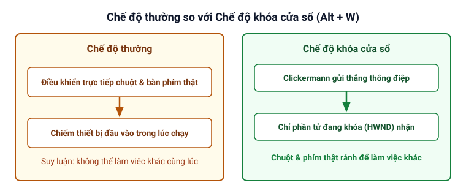
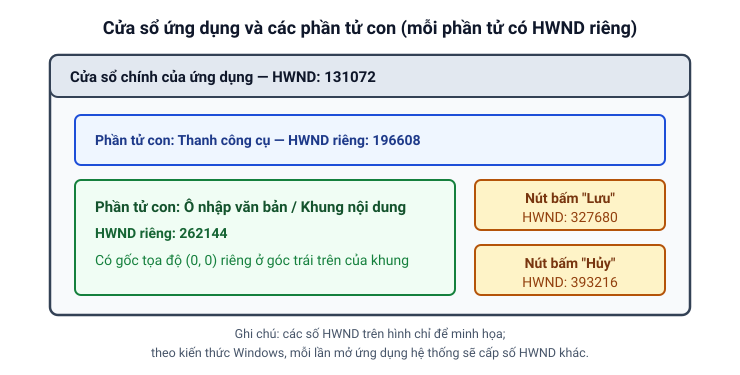
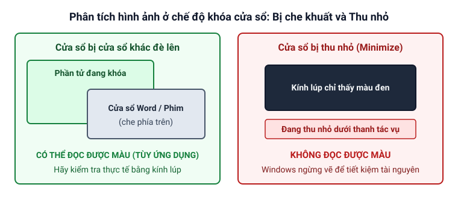

# Chế độ khóa cửa sổ

Trang này giải thích bản chất của **chế độ khóa cửa sổ** trong Clickermann, khái niệm cửa sổ và phần tử con trong Windows, cách bật và tắt khóa cửa sổ, cùng các điều kiện để đọc được màu sắc.

## Chế độ khóa cửa sổ là gì?

Ở chế độ thường, Clickermann điều khiển trực tiếp con trỏ chuột và bàn phím của máy tính (Suy luận: vì con trỏ chuột và bàn phím thật bị chiếm dụng nên trong lúc script đang chạy, bạn không thể dùng chuột hay gõ phím để làm việc khác cùng lúc).

Khi bật **chế độ khóa cửa sổ**, Clickermann sẽ khóa mục tiêu vào một phần tử cửa sổ cụ thể và chỉ gửi các thông điệp thao tác thẳng tới phần tử đó. Nhờ vậy, nếu ứng dụng đích cho phép nhận thông điệp ở chế độ này, **cả Clickermann và bạn có thể làm việc đồng thời trên cùng một máy tính mà không hề làm phiền nhau**.



## Bản chất "cửa sổ" và "phần tử con" trong Windows

Khái niệm "cửa sổ" của người dùng thông thường và của hệ điều hành Windows có điểm khác nhau:

- Với người dùng, một "cửa sổ" là cả khung chương trình lớn có nút đóng `[X]` ở góc phải trên.
- Nhưng đối với hệ điều hành Windows, mỗi nút bấm, nhãn chữ, thanh công cụ hay ô nhập văn bản bên trong khung chương trình đó đều là một **phần tử con** (cửa sổ con) độc lập. Một cửa sổ ứng dụng quen thuộc có thể chứa khoảng mười phần tử con như vậy.
- Mỗi phần tử đều có một mã số định danh duy nhất gọi là **`HWND`**. Khi đưa trỏ chuột lên bất kỳ vị trí nào, Clickermann sẽ hiển thị mã `HWND` của phần tử nằm ngay dưới mũi chuột tại mục "Khóa cửa sổ" trên màn hình chính (kèm theo mã tiến trình `PID` và tên tệp `.exe`). Ngoài ra, ngôn ngữ script còn có một số lệnh cho phép lấy mã `HWND` trong lúc script đang chạy. Suy luận: đó là các lệnh như [`WNDFIND`](/lenh/winapi#wndfind) và [`HGET`](/lenh/winapi#hget) trong nhóm lệnh WinAPI.



## Cách bật khóa cửa sổ và hệ tọa độ

Chế độ khóa cửa sổ được bật bằng tổ hợp phím tắt vì tại thời điểm khóa, mũi trỏ chuột của bạn cần phải đang trỏ đúng vào phần tử mục tiêu:

1. Đưa con trỏ chuột trỏ vào **phần tử mục tiêu** cần tự động hóa (ví dụ khung nội dung bên trong cửa sổ ứng dụng hoặc khung Flash trong trình duyệt — bản thân khung đó cũng là một phần tử có `HWND` riêng).
2. Nhấn tổ hợp phím **`Alt + W`** (mặc định).
3. Chương trình sẽ bắt lấy phần tử dưới trỏ chuột làm **phần tử đang khóa**. Từ lúc này, số `HWND` trên màn hình chính sẽ đứng yên ở mã của phần tử đang khóa.

Ngoài ra, bạn cũng có thể bật hoặc đổi phần tử đang khóa ngay trong code bằng lệnh [`HSET(hwnd, 1)`](/lenh/winapi#hset).

**Thay đổi về hệ tọa độ:**

- Cú pháp các lệnh trong script giữ nguyên giữa chế độ thường và chế độ khóa cửa sổ.
- **Điểm khác biệt chính** khi viết lệnh là hệ tọa độ: mỗi phần tử con có **hệ tọa độ tương đối riêng** với điểm `(0, 0)` nằm ở góc trái trên của chính phần tử đó. Dù bạn di chuyển cửa sổ ứng dụng sang vị trí khác trên màn hình, hệ tọa độ bên trong phần tử đang khóa vẫn không thay đổi (nếu ứng dụng cho phép hoạt động ở chế độ khóa cửa sổ).

## Tắt khóa cửa sổ

Trong script, để tắt chế độ khóa cửa sổ và quay về chế độ điều khiển toàn màn hình, bạn gọi thủ tục [`HSET(hwnd, state)`](/lenh/winapi#hset) với tham số trạng thái `state = 0` (trong đó `hwnd` là mã `HWND` của phần tử, ví dụ truyền biến hệ thống `$_hwnd` của phần tử đang khóa):

```cms
// Tắt chế độ khóa cửa sổ bằng cách đặt state = 0
HSET($_hwnd, 0)
HALT
```

*(Lưu ý: nếu chỉ muốn đổi sang khóa một phần tử khác, bạn gọi thẳng `HSET(hwnd_moi, 1)` mà không cần tắt trước bằng cờ `0`. Việc gọi `HSET(0, 0)` với `hwnd = 0` hoặc nhấn lại phím tắt `Alt + W` lần thứ hai có tắt được khóa cửa sổ hay không được ghi nhận tại [Cần kiểm tra trên Windows](/phu-luc/can-kiem-tra-tren-windows#cach-tat-che-do-khoa-cua-so)).*

## Khi nào đọc được màu ở chế độ khóa cửa sổ?

Các lệnh phân tích màn hình (như [`GETSCREEN`](/lenh/man-hinh#getscreen), [`IF_PIXEL_IN`](/lenh/man-hinh#if-pixel-in-end-if), [`IF_PICTURE_IN`](/lenh/man-hinh#if-picture-in-end-if)) ở chế độ khóa cửa sổ tuân theo quy tắc sau:

- **Cửa sổ bị che khuất bởi cửa sổ khác:** **Có thể đọc được màu, tùy ứng dụng; hãy kiểm tra bằng kính lúp**. Trong một số trường hợp, bạn có thể mở cửa sổ Word hoặc xem phim đè lên trên cửa sổ đang khóa mà script vẫn phân tích được đồ họa.
- **Cửa sổ bị thu nhỏ xuống thanh tác vụ (Minimize):** **Không đọc được màu**. Lý do là khi cửa sổ bị thu nhỏ xuống thanh tác vụ, Windows ngừng vẽ đồ họa của cửa sổ đó để tiết kiệm tài nguyên hệ thống.



**Cách kiểm tra nhanh:** Sau khi bật khóa cửa sổ, hãy mở [Trình soạn thảo](/bat-dau/trinh-soan-thao) và bật **kính lúp**. Nếu màu sắc/hình ảnh trong kính lúp vẫn thay đổi ngay cả khi có cửa sổ khác đè lên thì mọi thứ hoạt động tốt; ngược lại nếu kính lúp luôn chỉ có màu đen thì không phân tích hình ảnh ở chế độ khóa cửa sổ được. *(Hãy nhớ **tắt kính lúp** sau khi kiểm tra xong nếu thấy con trỏ chuột di chuyển chậm).*

## Giới hạn và giải pháp dùng máy ảo

- Không phải ứng dụng nào cũng cho phép hoạt động ở chế độ khóa cửa sổ; khả năng hoạt động phụ thuộc vào cách ứng dụng đích được viết. Lệnh [`MOVER`](/lenh/chuot#mover) cũng không hoạt động ở chế độ khóa cửa sổ.
- 🟠 **Lưu ý về trình duyệt web và máy ảo:**
  - **Nên làm:** Với trình duyệt web, hãy trỏ chuột vào đúng phần tử nội dung bên trong trang rồi nhấn `Alt + W` và bật kính lúp kiểm tra thử (thử đổi trình duyệt khác như Firefox nếu Chrome không nhận). Nếu ứng dụng hoàn toàn không nhận chế độ khóa cửa sổ, bạn có thể cài cả Windows, ứng dụng và Clickermann vào **bên trong máy ảo** rồi chạy ở chế độ thường trong máy ảo đó.
  ::: details Vì sao chưa chắc
  - **Theo sách của Chô tô (tr. 19):** Xếp chung trình duyệt và máy ảo vào nhóm cửa sổ không nhận Clickermann ở chế độ khóa cửa sổ.
  - **Theo help (bài Khóa cửa sổ và phần FAQ):** Giải thích rằng khả năng hoạt động ở chế độ khóa cửa sổ **tùy cách ứng dụng được viết** (ví dụ khung Flash trong trình duyệt là một phần tử con riêng, hoặc có trường hợp chạy được trên Firefox nhưng không chạy trên Google Chrome).
  - **Giải pháp dùng máy ảo (theo help, bài Khóa cửa sổ):** Với máy ảo (như MS Virtual PC, VMware), help gợi ý đây là **giải pháp thay thế** khi chế độ khóa cửa sổ không dùng được: bạn cài hệ điều hành, ứng dụng và Clickermann **vào bên trong máy ảo**, cho chạy ở chế độ thường bên trong máy ảo rồi thu nhỏ cửa sổ máy ảo xuống để làm việc khác trên máy thật. Tuy nhiên, help lưu ý cách này đòi hỏi máy tính đủ mạnh để gánh hai hệ điều hành cùng ứng dụng, và một số ứng dụng chạy khá kém hoặc từ chối chạy trên máy ảo. Xem thêm tại [Cần kiểm tra trên Windows](/phu-luc/can-kiem-tra-tren-windows#che-do-khoa-cua-so-voi-trinh-duyet-va-may-ao).
  :::

---

*Nguồn: Tài liệu trợ giúp `help.chm` (bài Khóa cửa sổ, mục WinAPI và khóa cửa sổ, mục Chuột và phần FAQ); tham khảo đối chiếu sách của Chô tô (tr. 19).*
