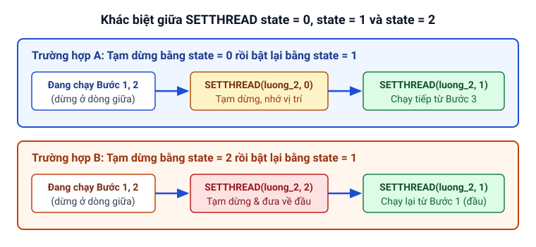

# Luồng (THREAD)

Trang này giải thích cách hoạt động của đa luồng (`THREAD`) trong Clickermann, cách các luồng chia sẻ biến và bộ đệm ảnh, quy tắc dùng chương trình con trong luồng và cách điều khiển trạng thái luồng bằng `SETTHREAD`.

**Trạng thái:** 🟠 Chưa thống nhất

## Luồng trong Clickermann là gì?

Theo help, mục Cấu trúc lệnh, một **luồng** (khai báo bằng khối [`THREAD ... END_THREAD`](/lenh/cau-truc#thread-end-thread)) là một chuỗi hành động độc lập chạy **đồng thời (song song)** với script chính và với các luồng khác.

Suy luận (từ ví dụ trong help, mục Cấu trúc lệnh khi thân luồng không có vòng lặp riêng nhưng vẫn lặp lại hành động): khi thân luồng chạy hết câu lệnh trước `END_THREAD`, luồng đó tự động quay lại dòng đầu tiên của thân luồng để lặp lại (giống như script chính), cho tới khi bị tạm dừng hoặc khi script chính dừng lại.

## Các đặc điểm kỹ thuật của luồng

Mỗi luồng trong Clickermann có 6 đặc điểm quan trọng được nêu trong help, mục Cấu trúc lệnh:

1. **Hai trạng thái hoạt động:** Mỗi luồng luôn ở một trong hai trạng thái: **đang chạy** (thực thi các câu lệnh trong thân luồng) hoặc **tạm dừng** (đứng yên, không thực thi).
2. **Bộ đếm thời gian riêng:** Mỗi luồng có bộ hẹn giờ độc lập. Các lệnh chờ như [`WAIT`](/lenh/kich-ban#wait), [`WAITMS`](/lenh/kich-ban#waitms) hoặc độ trễ thực thi lệnh bên trong một luồng hoàn toàn **không làm chậm hay chặn** script chính cũng như các luồng khác.
3. **Chương trình con (`SUB`) phải nằm riêng trong từng luồng:** Nếu một luồng cần gọi chương trình con (`SUB`), khối `SUB ... END_SUB` đó **bắt buộc phải được khai báo và gọi ngay bên trong thân của chính luồng đó**. Việc khai báo `SUB` ở ngoài rồi gọi từ trong luồng (hoặc ngược lại) không được phép và sẽ gây lỗi.
4. **Dùng chung biến và bộ đệm ảnh:** Tất cả các luồng và script chính đều hoạt động trong **cùng một phạm vi dữ liệu (scope)** — tức là mọi biến (`$var`) và **bộ đệm ảnh** đều được dùng chung và có thể đọc/ghi từ bất kỳ luồng nào.
5. **Điều khiển qua `SETTHREAD`:** Bạn có thể tạm dừng, cho chạy tiếp hoặc đặt lại một luồng từ script bằng thủ tục [`SETTHREAD`](/lenh/cau-truc#setthread).
6. **Đồng bộ với nút Chạy/Dừng của chương trình:** Khi bấm chạy script từ giao diện chính, các luồng nhận trạng thái ban đầu theo khai báo `THREAD`. Khi người dùng bấm Tạm dừng (Pause) hoặc Dừng hẳn (Stop) script chính, tất cả các luồng cũng tạm dừng hoặc dừng theo. (Lưu ý từ help, Lịch sử phiên bản v4.12.001: khi bỏ tạm dừng chương trình, các luồng đã bị dừng chủ động bằng lệnh trong script trước đó sẽ không tự chạy lại).

## Điều khiển luồng bằng `SETTHREAD`

Thủ tục [`SETTHREAD(thread_name, state)`](/lenh/cau-truc#setthread) nhận 3 giá trị trạng thái `state` theo help:

- `state = 0`: Tạm dừng luồng tại vị trí câu lệnh hiện tại.
- `state = 1`: Gỡ tạm dừng để luồng chạy tiếp từ đúng vị trí đã dừng trước đó.
- `state = 2`: Tạm dừng luồng, đồng thời **đưa vị trí thực thi về lại đầu luồng** (lần sau khi gọi `SETTHREAD(thread_name, 1)`, luồng sẽ chạy lại từ câu lệnh đầu tiên trong thân `THREAD`).



## Ví dụ phối hợp nhiều luồng

```cms
// Luồng 1: chạy ngay từ đầu (truyền rõ init_state = 1)
THREAD(luong_1, 1)
   PRINT("Luong 1: tich-tac moi 5 giay")
   WAIT(5)
END_THREAD

// Luồng 2: khởi tạo ở trạng thái tạm dừng (init_state = 0)
THREAD(luong_2, 0)
   PRINT("Luong 2: bat dau chay")
   WAIT(2)
   PRINT("Luong 2: buoc tiep theo")
   WAIT(2)
END_THREAD

// Script chính: chờ 3 giây rồi bật luồng 2
WAIT(3)
PRINT("Script chinh: bat luong 2")
SETTHREAD(luong_2, 1)

WAIT(6)
PRINT("Script chinh: dung han")
HALT
```

## Hai điểm chưa thống nhất cần lưu ý

- 🟠 **Trạng thái mặc định khi bỏ trống `init_state` trong `THREAD(thread_name)`:** Ví dụ của help không truyền `init_state` và mô tả các luồng chạy ngay (`1`), trong khi sách của Chô tô (tr. 82) nói không ghi `init_state` thì luồng đang tắt (`0`). Bạn nên luôn viết rõ `THREAD(ten, 1)` hoặc `THREAD(ten, 0)`. Xem chi tiết và script kiểm chứng tại [Trạng thái mặc định của THREAD khi bỏ qua init_state](/phu-luc/can-kiem-tra-tren-windows#trang-thai-mac-dinh-cua-thread-khi-bo-qua-init-state).
- 🟠 **Giá trị `state = 2` của `SETTHREAD`:** Help mô tả đủ 3 giá trị `0`, `1`, `2`; sách của Chô tô (tr. 83) chỉ nêu `0` và `1`. Xem chi tiết và script kiểm chứng tại [Các giá trị state của SETTHREAD](/phu-luc/can-kiem-tra-tren-windows#cac-gia-tri-state-cua-setthread).
