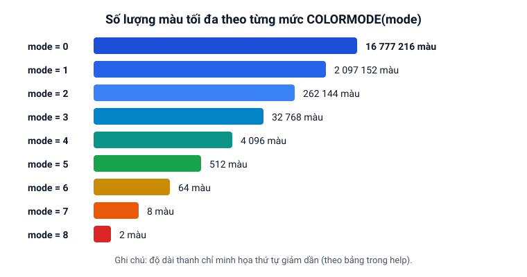

# Màu sắc và giảm màu (COLORMODE)

Trang này giải thích cách biểu diễn mã màu điểm ảnh trong Clickermann và cách dùng bộ lọc **giảm màu** (`COLORMODE`) để nhận diện hình ảnh ổn định hơn khi màu sắc trên màn hình biến đổi nhẹ.

**Trạng thái:** 🟡 Theo help, chưa chạy thử

## Mã màu của điểm ảnh

Mỗi điểm ảnh trên màn hình có màu sắc được tạo thành từ 3 kênh màu cơ bản: **Đỏ (Red)**, **Xanh lá (Green)** và **Xanh dương (Blue)**, mỗi kênh có giá trị từ `0` đến `255`.

Để thuận tiện khi viết lệnh, Clickermann gộp 3 kênh màu này thành **một con số nguyên duy nhất** gọi là mã màu (ví dụ màu đỏ thuần có mã số là `255`, màu xanh lá thuần là `65280`). Bạn có thể:

- Xem nhanh mã màu dưới trỏ chuột trong khung thông tin của [Trình soạn thảo](/bat-dau/trinh-soan-thao) (hoặc nhấn `Alt + Q`).
- Dùng hàm [`PXL(x, y)`](/lenh/man-hinh#pxl) để đọc mã màu tại tọa độ `(x, y)` trong bộ đệm ảnh.
- Dùng [`COLORGEN(r, g, b)`](/lenh/man-hinh#colorgen) để ghép 3 kênh màu thành mã màu, hoặc [`COLORR`](/lenh/man-hinh#colorr-colorg-colorb), `COLORG`, `COLORB` để tách mã màu ra từng kênh.

## Tại sao cần giảm màu (`COLORMODE`)?

Theo help, bài Giảm màu, việc thiết lập giảm màu giúp đơn giản hóa việc nhận diện đồ họa của Clickermann. **Giảm màu** (`COLORMODE`) là việc áp dụng các thuật toán đưa những màu sắc có sắc thái gần nhau về một mẫu số chung, giúp tránh tình huống màu của điểm ảnh hơi thay đổi nhẹ trong phạm vi sắc thái của nó (ví dụ lúc sáng hơn một chút, lúc tối hơn một chút) khiến Clickermann không tìm thấy hình ảnh.

Nhờ giảm màu (theo help, bài Giảm màu):

- Số lượng màu duy nhất trên bức ảnh giảm đi hàng chục lần (ví dụ minh họa trong help, bài Giảm màu: từ `5581` màu ở `COLORMODE(0)` giảm xuống còn `107` màu ở `COLORMODE(5)` và `29` màu ở `COLORMODE(6)`).
- Bức ảnh trở nên **đồng nhất hơn**, giúp các hiệu ứng chuyển động không còn cản trở việc tìm kiếm đối tượng qua vùng màu đồng nhất.

## Hai cách xem và áp dụng giảm màu

1. **Xem thử trên Kính lúp của trình soạn thảo:** Khi bật kính lúp, bạn có thể bấm nút chuyển mức giảm màu ở góc phải dưới kính lúp (từ `0` đến `7`) để quan sát trực tiếp xem ở mức nào thì vật thể cần tìm có vùng màu đồng nhất rõ nhất. Lưu ý: nút trên kính lúp chỉ để quan sát, không tự động áp dụng vào script.
2. **Áp dụng trong script bằng lệnh `COLORMODE`:** Sau khi gọi [`GETSCREEN`](/lenh/man-hinh#getscreen), bạn gọi thủ tục [`COLORMODE(mode, [x1, y1, x2, y2])`](/lenh/man-hinh#colormode) để lọc giảm màu cho bức ảnh trong bộ đệm ảnh. Bạn có thể áp dụng giảm màu cho toàn bộ bộ đệm ảnh, hoặc áp dụng có chọn lọc cho từng vùng (thậm chí mỗi vùng trong bộ đệm dùng một mức giảm màu riêng theo help, bài Giảm màu).



## Các quy tắc quan trọng khi dùng `COLORMODE`

- **Chỉ lọc vùng cần thiết:** Vùng xử lý càng lớn thì script càng tốn thời gian thực thi lệnh `COLORMODE` (theo help, bài Giảm màu). Vì vậy bạn chỉ nên áp dụng giảm màu cho những vùng trong bộ đệm ảnh mà script thực sự làm việc (`COLORMODE(mode, x1, y1, x2, y2)`).
- **Chỉ tăng mức một chiều trên cùng một ảnh chụp:** Bạn có thể gọi `COLORMODE(1)` rồi gọi tiếp `COLORMODE(2)`, `COLORMODE(3)`... trên cùng một bức ảnh mà không cần gọi lại `GETSCREEN`. Nhưng không thể đi ngược từ ít màu về nhiều màu — muốn có lại ảnh gốc đầy đủ màu, bạn phải gọi lại `GETSCREEN` (theo help, mục Màn hình).
- **Ảnh mẫu `.bmp` cũng phải được giảm màu cùng mức:** Nếu dùng [`IF_PICTURE_IN`](/lenh/man-hinh#if-picture-in-end-if) hoặc [`SCANPICTURE`](/lenh/man-hinh#scanpicture) sau khi gọi `COLORMODE(5)`, tệp ảnh mẫu `.bmp` đem đi so sánh cũng bắt buộc phải được chụp ở đúng mức `COLORMODE(5)`. Cách chuẩn bị (theo help, bài Trình soạn thảo và mục Màn hình): bật kính lúp trong trình soạn thảo, bấm nút chuyển mức giảm màu dưới kính lúp về mức tương ứng (ví dụ mức `5`), đưa chuột tới vùng cần chụp và nhấn `Alt + G` để chụp nhanh ảnh `100×100` đã áp dụng giảm màu thành tệp `.bmp`, rồi mở trong Paint để cắt gọn phần cần dùng (hoặc chạy một script nhỏ gọi `GETSCREEN` -> `COLORMODE(5)` -> `SCREENSHOT`).

```cms
// Chụp màn hình và áp dụng giảm màu mức 5 cho vùng (10, 20) -> (300, 300)
GETSCREEN(10, 20, 300, 300)
COLORMODE(5, 10, 20, 300, 300)

// Tìm ảnh mẫu đã được lưu ở cùng mức COLORMODE(5)
IF_PICTURE_IN(10, 20, 300, 300, "mau_colormode5.bmp")
   LCLICK($_return1, $_return2)
END_IF

HALT
```
