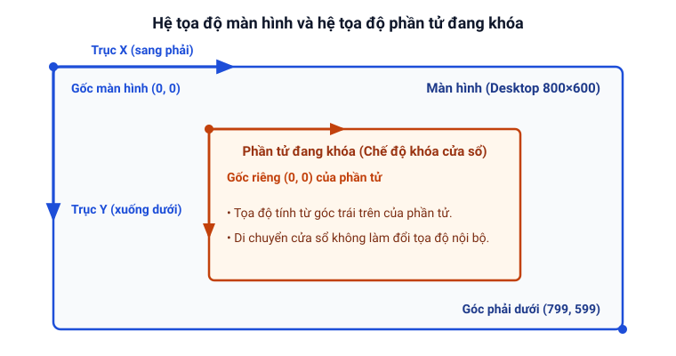

# Hệ tọa độ màn hình và phần tử

Trang này giải thích cách xác định tọa độ điểm ảnh `(x, y)` trên màn hình và sự thay đổi sang hệ tọa độ tương đối khi bật chế độ khóa cửa sổ.

**Trạng thái:** 🟡 Theo help, chưa chạy thử

## Tọa độ tuyệt đối trên màn hình

Theo help, mục Màn hình, màn hình máy tính là một lưới hình chữ nhật gồm các điểm ảnh (pixel):

- Điểm ảnh ở **góc trái trên cùng** của màn hình luôn có tọa độ là **`(0, 0)`**.
- Trục hoành **`X`** tăng dần từ trái sang phải.
- Trục tung **`Y`** tăng dần từ trên xuống dưới.
- Nếu màn hình của bạn có độ phân giải `800×600`, điểm ảnh ở góc phải dưới cùng sẽ có tọa độ là `(799, 599)`.
- Khi dùng nhiều màn hình ghép nối (Extended Desktop), Clickermann hỗ trợ đầy đủ cả tọa độ dương lẫn tọa độ âm (theo help, phần FAQ).

## Tọa độ tương đối của phần tử đang khóa

Khi bạn bật **chế độ khóa cửa sổ** (`Alt + W` hoặc lệnh [`HSET`](/lenh/winapi#hset)), hệ tọa độ trong cả trình soạn thảo lẫn khi chạy script sẽ tự động chuyển sang **hệ tọa độ tương đối của phần tử đang khóa** (theo help, bài Khóa cửa sổ):

- Gốc tọa độ **`(0, 0)`** lúc này nằm tại **góc trái trên cùng của chính phần tử đang khóa** (không còn là góc trái trên của màn hình desktop).
- Hệ tọa độ này được gọi là *tương đối* vì ngay cả khi bạn kéo cửa sổ ứng dụng đi chỗ khác trên màn hình, tọa độ nội bộ của các điểm bên trong phần tử đó vẫn giữ nguyên không đổi.

## Hai biến hệ thống `$_xmax` và `$_ymax`

Trong bảng biến hệ thống (help, phần Giới thiệu ngôn ngữ), Clickermann cung cấp hai biến `$_xmax` và `$_ymax`:

- 🟠 **Điểm chưa thống nhất giữa help và sách của Chô tô:**
  - **Theo help (phần Giới thiệu ngôn ngữ):** `$_xmax` và `$_ymax` là giá trị tọa độ X, Y lớn nhất cho phép, được **tính từ cấu hình màn hình desktop**.
  - **Theo sách của Chô tô (tr. 26):** Ghi rằng `$_xmax` và `$_ymax` là **tọa độ lớn nhất của cửa sổ**.
  - Suy luận: ở chế độ thường toàn màn hình thì hai cách nói cho kết quả gần giống nhau, nhưng khi đang bật chế độ khóa cửa sổ vào một cửa sổ nhỏ thì hai cách hiểu này sẽ khác nhau. Xem script kiểm chứng tại [Cần kiểm tra trên Windows](/phu-luc/can-kiem-tra-tren-windows#gia-tri-cua-xmax-va-ymax-khi-khoa-cua-so).
