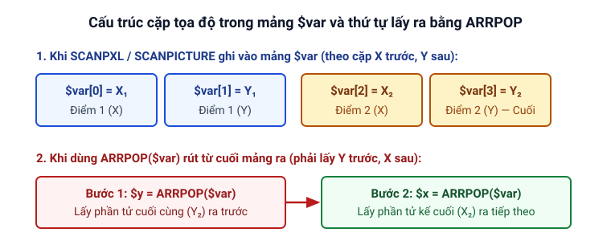

# Màn hình và màu sắc

Trang này hướng dẫn các thủ tục và hàm dùng để chụp ảnh màn hình vào **bộ đệm ảnh**, đọc và đếm màu điểm ảnh (pixel), tìm màu hoặc tìm ảnh mẫu `.bmp`, giảm màu và lưu ảnh chụp ra đĩa.

Màn hình là một lưới hình chữ nhật gồm các điểm ảnh (pixel) có tọa độ bắt đầu từ góc trái trên là `(0, 0)` (ví dụ với độ phân giải `800x600` thì góc phải dưới là `799, 599`). Ngoài tọa độ, mỗi điểm ảnh có một màu riêng tạo từ ba kênh màu Đỏ, Xanh lá và Xanh dương; ba kênh này được mã hóa gộp thành một con số duy nhất làm mã màu của điểm ảnh. Để linh hoạt và thuận tiện, Clickermann không làm việc trực tiếp với màn hình đang hiển thị mà làm việc với ảnh chụp lưu trong **bộ đệm ảnh**: cách này thứ nhất giúp tăng tốc độ xử lý, thứ hai tạo cho chương trình một dạng "trí nhớ thị giác" (tại mỗi thời điểm trong bộ nhớ chỉ lưu một ảnh chụp màn hình). Bạn cần gọi [`GETSCREEN`](#getscreen) mỗi khi muốn cập nhật ảnh mới từ màn hình vào bộ đệm ảnh.

## GETSCREEN

Chụp ảnh màn hình hiện tại và đưa vào bộ đệm ảnh của chương trình.

**Loại:** thủ tục · **Trạng thái:** 🟡 Theo help, chưa chạy thử

```cms
GETSCREEN ([x1, y1, x2, y2])
```

| Tham số | Kiểu | Bắt buộc | Mặc định | Ý nghĩa |
|---|---|---|---|---|
| `x1, y1, x2, y2` | số | không | toàn bộ màn hình | Tọa độ mô tả vùng màn hình cần cập nhật |

**Ví dụ**

```cms
// Chụp toàn bộ màn hình vào bộ đệm ảnh
GETSCREEN

// Chỉ cập nhật vùng hình chữ nhật từ (10, 20) đến (300, 200)
GETSCREEN(10, 20, 300, 200)
HALT
```

**Lưu ý**

- Thủ tục này đưa ảnh chụp màn hình vào bộ đệm của chương trình, và tất cả các hàm đồ họa gọi trong script đều lấy dữ liệu từ bộ đệm đó. Khi cần cập nhật lại trạng thái màn hình lưu trong bộ nhớ, hãy gọi `GETSCREEN` lần nữa.
- Nếu truyền các tham số mô tả vùng `x1, y1, x2, y2`, chỉ vùng tương ứng trong bộ đệm ảnh được cập nhật; trên một số hệ thống, cách này giúp lệnh chạy nhanh hơn. (Suy luận: khi đang bật [chế độ khóa cửa sổ](/khai-niem/khoa-cua-so), vùng chụp tương ứng với phần tử đang khóa theo mô tả trong help, bài Khóa cửa sổ).

---

## PXL

Trả về mã màu của điểm ảnh tại tọa độ chỉ định trong bộ đệm ảnh.

**Loại:** hàm · **Trạng thái:** 🟡 Theo help, chưa chạy thử

```cms
PXL (x, y)
```

| Tham số | Kiểu | Bắt buộc | Mặc định | Ý nghĩa |
|---|---|---|---|---|
| `x, y` | số | có | | Tọa độ của điểm ảnh cần lấy mã màu |

**Trả về:** Mã số màu của điểm ảnh tại `(x, y)`.

**Ví dụ**

```cms
GETSCREEN
$clr = PXL(50, 50)
PRINT("Ma mau: ", $clr)
HALT
```

---

## PXLCOUNT

Đếm số lượng điểm ảnh có màu chỉ định nằm trong một vùng hình chữ nhật của bộ đệm ảnh.

**Loại:** hàm · **Trạng thái:** 🟡 Theo help, chưa chạy thử

```cms
PXLCOUNT (x, y, x2, y2, color)
```

| Tham số | Kiểu | Bắt buộc | Mặc định | Ý nghĩa |
|---|---|---|---|---|
| `x, y` | số | có | | Tọa độ góc trái trên của vùng tìm kiếm |
| `x2, y2` | số | có | | Tọa độ góc phải dưới của vùng tìm kiếm |
| `color` | số | có | | Mã màu cần đếm |

**Trả về:** Số lượng điểm ảnh mang màu `color` tìm thấy trong vùng (trả về `0` nếu không có điểm ảnh nào khớp).

**Ví dụ**

```cms
GETSCREEN
$count = PXLCOUNT(10, 20, 100, 40, 255)
LOGWRITE("pixels: ", $count)
HALT
```

---

## PXLXOR

Tính tổng kiểm tra (checksum) của các điểm ảnh trong vùng chỉ định bằng phép toán XOR các mã màu.

**Loại:** hàm · **Trạng thái:** 🟡 Theo help, chưa chạy thử

```cms
PXLXOR (x, y, x2, y2)
```

| Tham số | Kiểu | Bắt buộc | Mặc định | Ý nghĩa |
|---|---|---|---|---|
| `x, y` | số | có | | Tọa độ góc trái trên của vùng cần tính |
| `x2, y2` | số | có | | Tọa độ góc phải dưới của vùng cần tính |

**Trả về:** Giá trị tổng kiểm tra XOR của vùng ảnh.

**Ví dụ**

```cms
GETSCREEN
$count = PXLXOR(10, 20, 100, 40)
LOGWRITE("Hash: ", $count)
HALT
```

**Lưu ý**

- Tổng kiểm tra dùng để nhận biết nhanh một vùng ảnh có thay đổi hay không (chỉ cần 1 pixel đổi màu thì kết quả tính lại sẽ khác đi).
- Cách tính bằng XOR rất nhanh nhưng độ tin cậy khi tạo mã nhận diện duy nhất cho các hình đơn giản không cao bằng [`PXLCRC`](#pxlcrc).

---

## PXLCRC

Tính tổng kiểm tra (checksum) của các điểm ảnh trong vùng chỉ định bằng thuật toán CRC32.

**Loại:** hàm · **Trạng thái:** 🟡 Theo help, chưa chạy thử

```cms
PXLCRC (x, y, x2, y2)
```

| Tham số | Kiểu | Bắt buộc | Mặc định | Ý nghĩa |
|---|---|---|---|---|
| `x, y` | số | có | | Tọa độ góc trái trên của vùng cần tính |
| `x2, y2` | số | có | | Tọa độ góc phải dưới của vùng cần tính |

**Trả về:** Mã băm CRC32 đại diện cho vùng ảnh.

**Ví dụ**

```cms
GETSCREEN
$count = PXLCRC(10, 20, 100, 40)
LOGWRITE("Hash: ", $count)
HALT
```

**Lưu ý**

- Phương pháp mới hơn để tính mã băm cho vùng màn hình, không có nhược điểm của [`PXLXOR`](#pxlxor), dù chạy chậm hơn khoảng hai lần.

---

## PXLREPLACE

Thay thế các điểm ảnh mang một màu xác định bằng màu mới ngay trong vùng chỉ định của bộ đệm ảnh.

**Loại:** thủ tục · **Trạng thái:** 🟡 Theo help, chưa chạy thử

```cms
PXLREPLACE (x, y, x2, y2, color, newcolor)
```

| Tham số | Kiểu | Bắt buộc | Mặc định | Ý nghĩa |
|---|---|---|---|---|
| `x, y` | số | có | | Tọa độ góc trái trên của vùng |
| `x2, y2` | số | có | | Tọa độ góc phải dưới của vùng |
| `color` | số | có | | Mã màu cũ cần bị thay thế (`-1` nếu muốn thay thế mọi màu) |
| `newcolor` | số | có | | Mã màu mới sẽ tô đè lên |

**Ví dụ**

```cms
GETSCREEN
PXLREPLACE(10, 20, 100, 40, -1, 255)
SCREENSHOT
HALT
```

**Lưu ý**

- Nếu muốn tô đè tất cả các điểm ảnh bất kể màu gốc trong vùng đó thành `newcolor`, hãy đặt tham số `color` bằng `-1`.

---

## IF_PIXEL_IN ... END_IF

Tìm kiếm điểm ảnh có màu chỉ định trong một vùng hình chữ nhật của bộ đệm ảnh và chạy khối lệnh nếu tìm thấy.

**Loại:** cấu trúc lệnh · **Trạng thái:** 🟡 Theo help, chưa chạy thử

```cms
IF_PIXEL_IN (x, y, x2, y2, color1, ...)
...
END_IF
```

| Tham số | Kiểu | Bắt buộc | Mặc định | Ý nghĩa |
|---|---|---|---|---|
| `x, y` | số | có | | Tọa độ góc trái trên của vùng tìm kiếm |
| `x2, y2` | số | có | | Tọa độ góc phải dưới của vùng tìm kiếm |
| `color1, ...` | số | có | | Một hoặc nhiều mã màu cần tìm |

**Trả về:** Khi tìm thấy, tọa độ X và Y của điểm ảnh đầu tiên khớp màu được ghi vào hai biến hệ thống `$_return1` (tọa độ X) và `$_return2` (tọa độ Y).

**Ví dụ**

```cms
GETSCREEN

// Tìm điểm ảnh màu đỏ (255)
IF_PIXEL_IN(10, 20, 100, 40, 255)
   LCLICK($_return1, $_return2)
END_IF

// Tìm điểm ảnh màu đỏ (255) hoặc xanh lá (65280)
IF_PIXEL_IN(10, 20, 100, 40, 255, 65280)
   LCLICK($_return1, $_return2)
END_IF

HALT
```

**Lưu ý**

- Ngay khi gặp điểm ảnh đầu tiên khớp màu, lệnh sẽ lưu tọa độ vào `$_return1`, `$_return2`, dừng việc quét tiếp và thực thi khối lệnh bên trong. Có thể kết hợp thêm nhánh [`ELSE`](/lenh/cau-truc#else).
- Cứ thêm mỗi một mã màu vào danh sách tìm kiếm, thời gian phân tích sẽ tăng thêm 100%.

---

## IF_PICTURE_IN ... END_IF

Tìm kiếm một hình ảnh mẫu (`.bmp`) trong vùng hình chữ nhật của bộ đệm ảnh và chạy khối lệnh nếu tìm thấy.

**Loại:** cấu trúc lệnh · **Trạng thái:** 🟡 Theo help, chưa chạy thử

```cms
IF_PICTURE_IN (x, y, x2, y2, file, [bgcolor], [currency])
...
END_IF
```

| Tham số | Kiểu | Bắt buộc | Mặc định | Ý nghĩa |
|---|---|---|---|---|
| `x, y` | số | có | | Tọa độ góc trái trên của vùng tìm kiếm |
| `x2, y2` | số | có | | Tọa độ góc phải dưới của vùng tìm kiếm |
| `file` | chuỗi | có | | Tên tệp ảnh `.bmp` cần tìm |
| `bgcolor` | số | không | `-1` | Mã màu nền của ảnh mẫu sẽ được bỏ qua khi đối chiếu (`-1` là không bỏ qua màu nào) |
| `currency` | số | không | `100` | Độ chính xác tìm kiếm tính theo phần trăm (`1..100`) |

**Trả về:** Khi tìm thấy, tọa độ góc trái trên của ảnh khớp đầu tiên được ghi vào hai biến hệ thống `$_return1` (tọa độ X) và `$_return2` (tọa độ Y).

**Ví dụ**

```cms
GETSCREEN
IF_PICTURE_IN(10, 20, 300, 300, "somefile.bmp")
   MOVE($_return1, $_return2)
END_IF
HALT
```

**Lưu ý**

- Hoạt động tương tự [`IF_PIXEL_IN ... END_IF`](#if-pixel-in-end-if): ngay khi tìm thấy vị trí đầu tiên khớp với ảnh mẫu, lệnh trả tọa độ góc trái trên của vùng khớp vào `$_return1`, `$_return2` và dừng phân tích. Có thể dùng kèm nhánh [`ELSE`](/lenh/cau-truc#else).
- Mặc định cần khớp 100% các điểm ảnh của tệp `.bmp` với ảnh chụp màn hình hiện tại. Nếu đặt `bgcolor`, màu nền đó của ảnh mẫu sẽ được bỏ qua khi tìm trên màn hình; nếu không đặt `bgcolor`, lệnh sẽ xét tất cả các điểm ảnh.
- Có thể đặt mức khớp thấp hơn 100% bằng tham số `currency`. Tham số `currency` quy định số điểm ảnh không khớp được bỏ qua khi phân tích; giá trị độ chính xác càng thấp thì thời gian tìm kiếm càng lâu. Nếu muốn đặt `currency` mà không dùng màu nền, hãy đặt `bgcolor` bằng `-1`.
- Tệp ảnh mẫu đầu vào phải đặt trong thư mục dự án, định dạng BMP chuẩn 24-bit. Nếu có dùng giảm màu [`COLORMODE`](#colormode), tệp ảnh đầu vào cũng phải được giảm màu trước: hãy lưu ảnh chụp màn hình định dạng `.bmp` sau khi gọi `COLORMODE()`, sau đó cắt mẫu trong trình chỉnh ảnh và lưu thành `.bmp`.

---

## SCANPICTURE

Tìm tất cả các vị trí xuất hiện của hình ảnh mẫu (`.bmp`) trong vùng chỉ định và lưu tọa độ các bản thể tìm thấy vào mảng.

**Loại:** thủ tục · **Trạng thái:** 🟡 Theo help, chưa chạy thử

```cms
SCANPICTURE ($var, x, y, x2, y2, file, [bgcolor], [currency])
```

| Tham số | Kiểu | Bắt buộc | Mặc định | Ý nghĩa |
|---|---|---|---|---|
| `$var` | mảng | có | | Mảng nhận danh sách tọa độ các vị trí tìm thấy |
| `x, y` | số | có | | Tọa độ góc trái trên của vùng tìm kiếm |
| `x2, y2` | số | có | | Tọa độ góc phải dưới của vùng tìm kiếm |
| `file` | chuỗi | có | | Tên tệp ảnh `.bmp` cần tìm |
| `bgcolor` | số | không | `-1` | Mã màu nền được bỏ qua của ảnh mẫu |
| `currency` | số | không | `100` | Độ chính xác tìm kiếm tính theo phần trăm (`1..100`) |

**Ví dụ**

```cms
GETSCREEN

// Tìm tất cả vị trí của ảnh pict.bmp trong vùng 0,0 - 1250,959
SCANPICTURE($var, 0, 0, 1250, 959, "pict.bmp")

// Lấy lần lượt từng cặp tọa độ từ mảng kết quả ra để in
WHILE(ARRSIZE($var) > 0)
   $y = ARRPOP($var)
   $x = ARRPOP($var)
   PRINT($x, ":", $y)
END_CYC

HALT
```

**Lưu ý**

- Các tham số và lưu ý khi hoạt động tương tự [`IF_PICTURE_IN ... END_IF`](#if-picture-in-end-if).
- Kết quả làm việc là mảng `$var`, trong đó tọa độ của các ảnh tìm thấy được thêm vào mảng: ảnh tìm thấy đầu tiên nằm ở `$var[0]` (X) và `$var[1]` (Y); ảnh thứ hai nằm ở `$var[2]` và `$var[3]`, v.v.
- `SCANPICTURE` và `SCANPXL` sử dụng mảng khi làm việc; help khuyên đọc thêm bài về mảng trên diễn đàn chính thức nếu chưa quen cách dùng mảng.

---

## SCANPXL

Tìm tất cả các điểm ảnh có màu chỉ định trong vùng hình chữ nhật của bộ đệm ảnh và lưu tọa độ vào mảng.

**Loại:** thủ tục · **Trạng thái:** 🟡 Theo help, chưa chạy thử

```cms
SCANPXL ($var, x, y, x2, y2, color)
```

| Tham số | Kiểu | Bắt buộc | Mặc định | Ý nghĩa |
|---|---|---|---|---|
| `$var` | mảng | có | | Mảng nhận danh sách tọa độ các điểm ảnh tìm thấy |
| `x, y` | số | có | | Tọa độ góc trái trên của vùng tìm kiếm |
| `x2, y2` | số | có | | Tọa độ góc phải dưới của vùng tìm kiếm |
| `color` | số | có | | Mã màu cần tìm |

**Ví dụ**

```cms
GETSCREEN

// Tìm tất cả điểm ảnh màu đỏ (255) trong vùng 0,0 - 1250,959
SCANPXL($var, 0, 0, 1250, 959, 255)

// In danh sách tọa độ tìm được
WHILE(ARRSIZE($var) > 0)
   $y = ARRPOP($var)
   $x = ARRPOP($var)
   PRINT($x, ":", $y)
END_CYC

HALT
```

**Lưu ý**

- Kết quả được lưu vào mảng `$var` theo từng cặp tọa độ X và Y: điểm ảnh đầu tiên ở `$var[0]` (X) và `$var[1]` (Y), điểm thứ hai ở `$var[2]` và `$var[3]`, v.v. Khi dùng `ARRPOP` để lấy từ cuối mảng ra, bạn cần lấy tọa độ Y trước rồi mới lấy X.



---

## SCREENSHOT

Lưu toàn bộ hình ảnh hiện có trong bộ đệm ảnh thành tệp ảnh `.bmp` trên ổ đĩa.

**Loại:** thủ tục · **Trạng thái:** 🟠 Chưa thống nhất

```cms
SCREENSHOT ([pref])
```

| Tham số | Kiểu | Bắt buộc | Mặc định | Ý nghĩa |
|---|---|---|---|---|
| `pref` | chuỗi | không | `"shot"` | Tiền tố đặt ở đầu tên tệp ảnh |

**Ví dụ**

```cms
GETSCREEN

// Tạo lần lượt các tệp error0000.bmp, error0001.bmp, error0002.bmp
SCREENSHOT("error")
SCREENSHOT("error")
SCREENSHOT("error")

// Tạo tệp shot0000.bmp
SCREENSHOT
HALT
```

**Lưu ý**

- Tệp ảnh được lưu vào thư mục con `screens` bên trong thư mục của script hiện tại, với tên dạng `pref0000.bmp` (số thứ tự `0000` tự động tăng dần khi lưu thêm ảnh mới) (theo help, mục Màn hình).
- Nếu đang bật chế độ khóa cửa sổ, ảnh chụp chỉ chứa phần tử đang khóa.
- 🟠 **Điểm chưa thống nhất khi so sánh giữa help và sách của Chô tô (tr. 94):** Help (mục Màn hình) ghi ảnh lưu định dạng `.bmp` trong thư mục con `screens`; sách của Chô tô (tr. 94) ghi ảnh lưu dưới định dạng `jpeg` trong thư mục `screen`. Xem script kiểm chứng tại [Cần kiểm tra trên Windows](/phu-luc/can-kiem-tra-tren-windows#thu-muc-luu-anh-cua-screenshotex).

---

## SCREENSHOTEX

Cắt một vùng hình chữ nhật từ bộ đệm ảnh và lưu thành tệp ảnh trên ổ đĩa.

**Loại:** thủ tục · **Trạng thái:** 🟠 Chưa thống nhất

```cms
SCREENSHOTEX (x1, y1, x2, y2, [pref], [format])
```

| Tham số | Kiểu | Bắt buộc | Mặc định | Ý nghĩa |
|---|---|---|---|---|
| `x1, y1, x2, y2` | số | có | | Bốn tọa độ xác định vùng ảnh cần lưu từ bộ đệm ảnh |
| `pref` | chuỗi | không | `"shot"` | Tiền tố đặt ở đầu tên tệp ảnh |
| `format` | số | không | `0` | Định dạng tệp ảnh: `0` — BMP; `1` — JPEG |

**Ví dụ**

```cms
GETSCREEN
// Lưu một vùng nhỏ ở góc trái trên màn hình
SCREENSHOTEX(10, 10, 50, 50)
HALT
```

**Lưu ý**

- Ảnh chụp được đặt trong thư mục con `screens` của thư mục script hiện tại với tên dạng `pref0000.bmp` (số thứ tự `0000` tăng dần khi cần). Help chỉ ghi tên dạng `pref0000.bmp`, không nói rõ đuôi file khi `format = 1`. Nếu đang ở chế độ khóa cửa sổ, vùng ảnh được cắt ra từ phần tử đang khóa.
- 🟠 **Điểm chưa thống nhất khi so sánh giữa help và sách của Chô tô và điểm help không nói rõ:**
  - **Theo help:** Ảnh chụp được lưu vào thư mục con `screens` (có chữ `s` ở cuối) trong thư mục của script hiện tại; tham số `format` bằng `0` là BMP, bằng `1` là JPEG, nhưng ở phần ghi chú help chỉ ghi tên file dạng `pref0000.bmp` mà không nói rõ đuôi file khi `format = 1`.
  - **Theo sách của Chô tô (tr. 94):** Sách ghi thư mục lưu ảnh tên là `screen` (không có chữ `s`), và trong phần lời giải thích nói ảnh lưu dưới dạng `.bmp` mặc dù ở phần tham số sách vẫn liệt kê `format = 1` là JPEG.
  - Xem script kiểm chứng tên thư mục và đuôi file khi `format = 1` tại [Cần kiểm tra trên Windows](/phu-luc/can-kiem-tra-tren-windows#thu-muc-luu-anh-cua-screenshotex).

---

## SCREENSHOTFIX

Cắt một vùng hình chữ nhật từ bộ đệm ảnh và lưu đè vào một đường dẫn tệp cố định trên ổ đĩa.

**Loại:** thủ tục · **Trạng thái:** 🟡 Theo help, chưa chạy thử

```cms
SCREENSHOTFIX (x1, y1, x2, y2, path, [format])
```

| Tham số | Kiểu | Bắt buộc | Mặc định | Ý nghĩa |
|---|---|---|---|---|
| `x1, y1, x2, y2` | số | có | | Bốn tọa độ xác định vùng ảnh cần lưu từ bộ đệm ảnh |
| `path` | chuỗi | có | | Đường dẫn tệp ảnh đích (tương đối hoặc tuyệt đối) |
| `format` | số | không | `0` | Định dạng tệp ảnh: `0` — BMP; `1` — JPEG |

**Ví dụ**

```cms
GETSCREEN
// Lưu vùng nhỏ góc trái trên vào đúng tệp D:\file.bmp
SCREENSHOTFIX(10, 10, 50, 50, "D:\file.bmp")
HALT
```

**Lưu ý**

- Khác với [`SCREENSHOTEX`](#screenshotex), tệp được lưu vào vị trí cụ thể theo đường dẫn tương đối hoặc tuyệt đối và ghi đè lại mỗi lần gọi. Nên đặt đuôi mở rộng của tệp trong `path` dựa theo tham số `format` (mặc định là `0`).

---

## COLORMODE

Áp dụng bộ lọc giảm màu cho hình ảnh đang lưu trong bộ đệm ảnh.

**Loại:** thủ tục · **Trạng thái:** 🟡 Theo help, chưa chạy thử

```cms
COLORMODE (mode, [x1, y1, x2, y2])
```

| Tham số | Kiểu | Bắt buộc | Mặc định | Ý nghĩa |
|---|---|---|---|---|
| `mode` | số | có | | Mức độ giảm màu (`0..8`) |
| `x1, y1, x2, y2` | số | không | toàn bộ ảnh | Vùng tọa độ trên bộ đệm ảnh cần áp dụng bộ lọc giảm màu |

**Ví dụ**

```cms
GETSCREEN
COLORMODE(5, 10, 10, 200, 200)
SCREENSHOT
HALT
```

**Lưu ý**

- Thủ tục thay đổi ảnh chụp màn hình hiện tại bằng cách áp dụng bộ lọc làm giảm số lượng màu trong bảng màu, đưa các sắc thái màu gần nhau về chung một mã màu để tránh trường hợp điểm ảnh hơi đổi độ sáng/tối làm Clickermann không tìm thấy ảnh (xem chi tiết tại [Màu sắc và giảm màu](/khai-niem/mau-sac)).
- Vì việc áp dụng bộ lọc cũng tốn thời gian, nếu không cần đổi toàn bộ ảnh chụp thì bạn nên chỉ định vùng tọa độ cụ thể `x1, y1, x2, y2` để tiết kiệm thời gian thực thi; nếu không truyền vùng thì bộ lọc áp dụng cho toàn bộ màn hình.
- Gọi `COLORMODE(0)` không có ý nghĩa. Có thể tăng dần mức `mode` một chiều (`1`, `2`, `3`...) mà không cần gọi lại `GETSCREEN`, nhưng không thể tăng ngược lại số lượng màu; muốn có ảnh chụp gốc "sạch" mới thì phải gọi lại `GETSCREEN`.
- Bảng số lượng màu tối đa ứng với từng mức `mode`:

| `mode` | Số màu tối đa |
|---|---|
| `0` | 16 777 216 |
| `1` | 2 097 152 |
| `2` | 262 144 |
| `3` | 32 768 |
| `4` | 4 096 |
| `5` | 512 |
| `6` | 64 |
| `7` | 8 |
| `8` | 2 |

---

## COLORGEN

Tạo mã số màu từ giá trị của ba kênh màu Đỏ (Red), Xanh lá (Green) và Xanh dương (Blue).

**Loại:** hàm · **Trạng thái:** 🟡 Theo help, chưa chạy thử

```cms
COLORGEN (red, green, blue)
```

| Tham số | Kiểu | Bắt buộc | Mặc định | Ý nghĩa |
|---|---|---|---|---|
| `red` | số | có | | Giá trị kênh màu Đỏ (`0..255`) |
| `green` | số | có | | Giá trị kênh màu Xanh lá (`0..255`) |
| `blue` | số | có | | Giá trị kênh màu Xanh dương (`0..255`) |

**Trả về:** Mã màu tổng hợp từ 3 kênh RGB.

**Ví dụ**

```cms
// Tạo mã màu từ 3 kênh RGB
$c = COLORGEN(234, 34, 65)

// Tách ngược lại từng kênh màu để kiểm tra
PRINT("red: ", COLORR($c)) // đỏ
PRINT("grn: ", COLORG($c)) // xanh lá
PRINT("blu: ", COLORB($c)) // xanh dương
HALT
```

---

## COLORR, COLORG, COLORB

Tách lấy giá trị của từng kênh màu Đỏ (`COLORR`), Xanh lá (`COLORG`) hoặc Xanh dương (`COLORB`) từ một mã màu.

**Loại:** hàm · **Trạng thái:** 🟡 Theo help, chưa chạy thử

```cms
COLORR (color)
COLORG (color)
COLORB (color)
```

| Tham số | Kiểu | Bắt buộc | Mặc định | Ý nghĩa |
|---|---|---|---|---|
| `color` | số | có | | Mã màu cần tách kênh |

**Trả về:** Giá trị từ `0` đến `255` của kênh màu Đỏ (`COLORR`), Xanh lá (`COLORG`) hoặc Xanh dương (`COLORB`).

**Ví dụ**

```cms
// Lấy một điểm ảnh ngẫu nhiên trên màn hình
GETSCREEN
$p = PXL(RND(0, 300), RND(0, 300))

// Tách ra 3 kênh màu RGB
PRINT("R:", COLORR($p))
PRINT("G:", COLORG($p))
PRINT("B:", COLORB($p))
HALT
```
